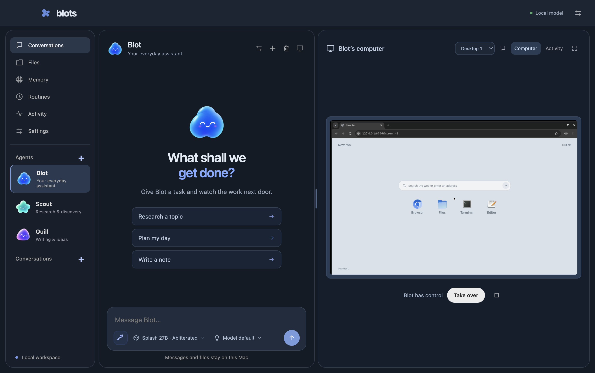

# Blots

**Your own little team.** A charcoal local AI desktop app with blue accents, built for Apple silicon Macs. Each bot has its own persistent Linux computer. The agent conversation is the main reading area, with a live Linux computer beside it. Extra desktops are available in the compact screen picker. Drag the divider to resize the computer pane, use arrow keys when the divider is focused, or double-click it to reset the split. Pane width is saved locally between launches. Expand the computer to watch more closely or take over its mouse and keyboard.

Blots is independently built software, not a fork of Bops. There is no Blots account, inference subscription, telemetry, or hosted backend. Inference and app data stay on your Mac. Web research connects to the websites you ask your bots to visit.



## Run on your Mac

1. Install Docker Desktop once. Blots starts it quietly in the background when a Linux desktop or image build needs it; you do not have to launch it manually. No Docker account is required to run local containers. If Docker needs first-run setup or another confirmation, open it to complete that step.
2. Run an OpenAI-compatible **local model server** with a tool-capable model loaded. Blots defaults to `http://127.0.0.1:8000/v1`. The app selects the first available model on first launch; change it in Settings. Ollama commonly uses `http://127.0.0.1:11434/v1`; LM Studio commonly uses `http://127.0.0.1:1234/v1`.
3. Open **Blots.app**. Click **Start computer** beside your bot. On a fresh machine, first choose **Settings → Build computer image**. This downloads and builds the Linux desktop once; subsequent starts use the local image.
4. Use the composer’s shield icon to choose **Ask** or **Auto** approval. Auto saves standing approval for the selected bot’s Linux commands, browser, mouse, keyboard, and shared workspace file writes. Once a task has read web content, Linux commands and background jobs ask again even in Auto, because a page could carry injected instructions. It defaults to Ask. Switching to Auto also approves a waiting Linux action; switching back to Ask restores prompts for subsequent actions. Mac system access is not added. The cube icon selects a local model, and the lightbulb selects reasoning. The reasoning menu offers Model default, Off, Low, Medium, and High for the two verified Qwen3.8 Splash packages; High sends their `xhigh` setting. Splash 35B A3B offers Model default (thinking on) and Off; its reasoning is a switch rather than graded levels. Unverified models use their own default with the picker disabled. Switching models resets reasoning, and each task keeps the choices made when it was sent.
5. Ask a bot to research a topic, draft a document, or organize files. Review requested writes and browser interactions. Click **Take over** to drive its real desktop; **Hand back** or Escape returns control.

Desktop limits apply on the next desktop start, including existing computers; their files and profiles remain. These are per-desktop ceilings, separate from Docker’s shared Linux VM and the inference server. Three desktops share the VM rather than booting three independent VMs. See [browsing runtime and resource checks](docs/browser-runtime.md).

The supplied Mac app bundles its own Electron/Node runtime. You do not need Node to launch it. Docker Desktop and the local inference server are separate prerequisites; model weights are not included.

## Splash models

The selected model on the development Mac is [`incoai/Qwen3.6-35B-A3B-Splash`](https://huggingface.co/incoai/Qwen3.6-35B-A3B-Splash), a Splash-specific mixture-of-experts package (35B total, about 3B active per token). It is not an Ollama/GGUF model. Install the Splash runtime, then serve it locally:

```sh
brew install incoai/tap/splash
splash serve --model incoai/Qwen3.6-35B-A3B-Splash
```

Select that model in Blots Settings. It is about 20 GB to download. On the development Mac, against [`audreyt/Qwen3.8-27B-Splash-abliterated`](https://huggingface.co/audreyt/Qwen3.8-27B-Splash-abliterated) with the same 26,000-token Blots task prompt, it loaded in 5.9 seconds instead of 10.6, processed the cold prompt in 10 seconds instead of 48, and generated 104 tokens per second instead of 32. On a Mac Calculator task and a browser, terminal and file task, both models produced the same correct results; the 35B finished in 18 and 27 seconds, the 27B in 72 and 60. The 35B offers thinking as on or off only, while the 27B packages also offer Low, Medium and High. Both 27B packages remain selectable. The development Mac's local gateway selects the requested Splash model and coordinates Splash/Sushi so only one model is resident, with idle offload after five minutes and explicit unloading on a normal Blots app quit. A fresh machine can use the direct command above instead.

## Build from source

Requirements: an Apple silicon Mac, Node 22+, npm, Docker Desktop, and a local model server supporting `/v1/models`, `/v1/chat/completions`, streaming, and function calls.

```sh
git clone https://github.com/anujk22/blots.git
cd blots
npm ci
npm run computer:build
npm start
```

For the native app:

```sh
npm run build
open dist.noindex/mac-arm64/Blots.app
```

For browser-based development: `npm run dev`, then open `http://127.0.0.1:4317`. The packaged desktop chooses an available loopback port automatically.

The desktop is built locally and unsigned for distribution; it is not a notarized App Store release.

## What works

- Multiple named bots with editable roles, instructions, and colors. Bots can delegate tasks to teammates; delegated tasks appear in their own conversations and share the local model's request slots.
- Persistent conversations with streamed local model responses.
- Live web search, real browser navigation, page reading, and numbered browser actions. Research bots can open sources and cite URLs; no paid search API is needed. Search defaults to DuckDuckGo's lightweight HTML results; Settings accepts any search address containing `{query}`, such as a local SearXNG instance. Page observations are compact: numbered elements are one line each, and long pages are read in pieces with `browser_read` and `start`.
- A real 1280 × 960 Linux computer per bot, with an inset Chromium browser, an agent-colored welcome screen, clock, portrait, patterned background, and a native browser/terminal/files dock. The app grid lists the installed tools. The default image includes Chromium, Mousepad, a terminal and Files; `npm run computer:build:full` adds Blender, Draw, FreeCAD, GIMP, Godot, Inkscape, Kdenlive, KiCad, OpenSCAD, ParaView, QGIS, and Solitaire (several GB). Each bot keeps one desktop. Its home folder, browser profile (logins, cookies) and installed packages persist across restarts; quitting Blots stops every desktop, and desktops left running by a crash are stopped on the next launch.
- Live VNC viewing, expansion, and mouse/keyboard takeover, with a wider conversation pane and the composer below the conversation. Agent tools wait while you have control of their screen.
- Local workspace listing, reading, file creation/editing, and downloads. Saved memories and new scheduled tasks come to you for review. Workspace file writes, browser actions, and Linux actions also ask unless Auto is enabled for that bot.
- Conversations grouped under each agent in the sidebar, plus incognito chats: the agent neither reads nor changes its memory there, and the conversation is never saved, so it is gone when Blots closes. Files saved to the workspace stay.
- Memory per agent: each agent sees its own memories plus any you mark as shared. The Memory page lists them per agent for editing and shows each agent's notebook (its project memory). Ask an agent to remember, correct or forget something in any chat; each change asks for your approval. Memory travels with each new request rather than in the system prompt; when saved memory exceeds about 4,000 characters, the notes sharing the most distinctive words with the request are included.
- Background jobs for commands longer than the 30-second shell limit: bots start a job, check its status and output tail, and stop it.
- Scheduled routines, created in the app or requested in chat, while the app is open. Results appear in their own conversations; reviewed actions still wait for you.
- Tool activity, cancellation, saved task continuation, data export, and local server/model settings. Long tasks default to 120 model turns or 120 minutes per session, with configurable budgets. Continue task restores saved progress after a pause or app restart.
- Two work styles. By default bots take the most direct route: pages are navigated and clicked through the browser, files are edited and commands run directly, and screenshots and the mouse are reserved for native apps. This takes far fewer model turns. **Settings → Show work on the desktop** switches to the visible style: searches and page opens use the real address bar, browser clicks and typing use the actual desktop pointer, and native apps prefer screenshot-guided GUI actions. Either way the desktop video shows the browser and any apps in use.
- Visible real mouse motion, clicking, hovering, scrolling, typing and key presses in Linux. The pointer is embedded in the live video so viewers can watch the work. Ordinary questions can still receive direct answers. The native cursor has an agent-colored glow and portrait badge, with eased motion timed at 60 updates per second.
- Three compact composer menus choose action approval, the local model, and the model's supported reasoning level. Hover labels show the current choices. Computer tools remain available; the agent decides when a question needs computer work.
- The context meter offers 64k, 128k and 256k task budgets, capped at what the model supports.
- A smarter loop around small local models:
  - **Adaptive thinking**: on models that can turn reasoning off, the model thinks on the first turn, after a failed or declined action, after a loop, when you add context, and before finishing. Routine turns after a successful result skip thinking. Turn it off in the reasoning menu.
  - **Plans**: for tasks with three or more steps, the agent keeps a checklist with the `plan` tool. The checklist rides at the end of each request, so it stays in view without disturbing the cached prompt, and the live activity shows it ticking off.
  - **Check before done**: after a task that used at least two tools, the agent checks its reply against the original request once. It can verify with tools or keep working. If it confirms, the original reply is kept.
  - **Learned routes**: after a task with three or more successful actions, the agent saves the route it took (not incognito). When a later goal is similar, it gets the closest route as an example. The Memory page lists each agent's routes, and you can forget any of them.
- Optional screenshot-based native app tools for **vision-capable** local models. Enable these in Settings. Ordinary browser research uses page text and works without vision.

## Tuned for Apple silicon

The Mac app and Linux image run natively on ARM64. Models run in your existing local server, not in Docker. Model requests use a configurable number of slots (Settings → Parallel model requests, default 1). Raise it only when your server batches sequences, such as `llama-server --parallel N`; decoding on Apple silicon is memory-bound, so a few batched sequences cost little more than one. Different bots always run computer actions concurrently. Turns for the same bot remain ordered so they cannot fight over its pointer. Only the first screen starts with a computer; the other three start when viewed or used. Each desktop defaults to a 1-CPU, 1-GiB limit, with Settings sliders for 1–4 CPUs and 1–4 GiB; at most three run at once. With one active screen each, three idle computers measured about 1.0 GiB combined on the development M5 Pro Mac, down from 3.5 GiB when every screen started eagerly. Opening additional screens or heavy applications increases usage. The model server and Docker VM have separate overhead. Computers start on demand and stop together when Blots quits; their data persists. Hidden viewers disconnect without stopping agent work. Browser HTTP caches are limited to 64 MiB per used screen; container logs rotate at 10 MiB. Only the latest screenshot batch is sent in later vision turns. Unchanged state polls return no body; polls carry only the open conversation's messages and trimmed step details, so their size does not grow with history. Progress updates during tasks are coalesced into one state write per half second, and saved state uses compact JSON. Agent screenshots are JPEG; models that ground on normalized coordinates receive a 1024-pixel-wide image, reducing vision tokens. The full Linux application image is shared by all bots; it is not copied for each computer.

Conversation context is bounded to the most recent 24 messages and 60,000 characters. Tool results are bounded and reply length is configurable. During tasks, context is managed in two stages, because small local models lose more from a rewritten summary than frontier models do. First, at 60% of the compaction threshold, older tool results become one-line stubs (their start, such as the page URL and title, plus a note to repeat the call if needed) and older thinking is dropped. Every action the bot took stays in the transcript, the latest three tool rounds stay complete, and stubs are applied in batches so local servers can keep reusing their cached prompt prefix between batches. Only if that is not enough is the transcript summarized, against a configurable 131,072-token (128k) default budget. The summary is followed by a record Blots builds from the action log rather than from the model: files saved, pages opened, searches, declined actions, and the bot's own notes for the conversation, verbatim. Browser reads return 8,000 characters at a time; use start to continue. The checkpoint request reuses the task's exact system prompt, tools and transcript with the instruction appended, so the model server answers it from its prompt cache: on the development Mac a 26,000-token checkpoint went from 43 seconds before the first token to 0.3 seconds. While you type in a conversation, Blots sends the next request's prefix ahead with a one-token request, which loads an offloaded model and fills the cache, so sending only processes the new message (a cold 26,000-token prefix took 48 seconds; cached, 0.7). Reported token usage and a text-size estimate, calibrated against the server's reported prompt size, inform both triggers; it is not an exact preflight token count. There is no fixed-turn compaction. The original goal, factual progress, and two recent tool rounds remain after a summary. Thinking is retained between tool calls and in paused checkpoints; older thinking is removed when it is included in a pressure-triggered summary. The output budget includes thinking and the visible reply, defaults to 16,384 tokens, and can be raised to 65,536. Only current screenshots are kept in memory; checkpoint files contain text, not image histories. This avoids uncontrolled context growth; it also means very long conversations do not all fit in a single prompt. Shared memory preserves the facts you choose to save. Each reply keeps a short record of the tool activity behind it, so follow-up questions can refer to what a bot actually saw and did. The system prompt is byte-stable for a given bot, team and settings, so local servers can reuse its cached prefix across tasks.

## Your data and boundaries

The packaged Mac app stores data in:

```text
~/Library/Application Support/Blots/
├── state.json             conversations, settings, memory, routines, activity
├── workspace/             shared files visible to you and your bots
├── tasks/<run-id>.json    text checkpoints for paused or interrupted tasks
└── computers/<bot-id>/    each computer's persistent Linux home and profiles
```

No Mac home directory, model API key, Docker socket, or system folder is mounted into a bot computer. The only Mac mounts are its own home storage and the shared Blots workspace. Linux commands run as an unprivileged user inside the computer. Workspace tools reject traversal and symlink escapes. Computers share the workspace intentionally.

The app server, desktop ports, and model connection are loopback-only. The app checks request origins and hosts; the renderer is sandboxed with Node disabled. Markdown is sanitized. API keys, when a local server needs one, stay in local settings and are excluded from exported backups. This is a single-user local app, not a multi-user remote service.

Quitting stops pending work. Reopening records interrupted tasks instead of repeating them automatically. Stopping prevents further model/tool steps; an already executing Linux command may finish or reach its 30-second limit. The default session pauses after 120 decision turns or two hours; Settings supports up to 1,000 turns and eight hours. Continue task retains the original goal and recorded results, obtains a fresh desktop screenshot when visual tools are enabled, and preserves denied actions. Four consecutive identical action-and-result rounds pause the task to avoid a simple loop. This does not detect every possible loop. Completed checkpoint files are removed and activity is bounded. See [long-task verification and model limits](docs/long-tasks.md).

## Mac apps (optional)

Bots keep their Linux computers; Mac control is an addition, off by default. Turn on **Settings → Let bots use apps on this Mac** and list the apps a bot may use by bundle identifier (**Check permissions and running apps** lists running apps; click one to add it). Blots needs Accessibility permission, and Screen Recording only for Mac screenshots, in System Settings → Privacy & Security.

Bots read an app's front window through the macOS accessibility tree, as numbered controls and visible text, and act on those numbers: press one or several controls in order (a whole calculator sequence is one step and one approval), replace a field's text, or press a listed shortcut. This works in background apps, without moving your pointer, for most controls; a few controls need a real click, which brings the app forward. A bot-colored cursor glides over the control before each action so you can see where it is about to act. Small local models are much more reliable choosing from numbered controls than locating buttons in screenshots.

Boundaries: every Mac action asks for approval, even in Auto. Reading an allowed app does not ask, and marks the task as having read untrusted content. Terminals, System Settings, Keychain Access, password managers, Script Editor, Activity Monitor and Blots itself can never be listed. Bots never type into password fields. Mac control needs the helper built with `npm run mac:build` (included in `npm run build`). Because the app is unsigned, macOS may ask for Accessibility permission again after each rebuild.

## Practical limits

Local model quality determines reasoning, tool selection, vision, and task success. Blots does not claim parity with proprietary frontier models. Websites can require sign-in, present CAPTCHAs, or restrict automation; take over when they need you. Search uses ordinary websites and remains subject to their availability. Voice calls, phone numbers, email provisioning and paid connector catalogs are not included. Mac apps can be operated only when you turn on Mac control and list them; see below. Routines do not run while Blots or the Mac is off.

The Linux computers are containers inside Docker Desktop's local Linux VM, not separate hardware VMs. The code is MIT licensed; dependencies retain their own licenses, including noVNC's MPL-2.0 license.

## Verification

```sh
npm test
npm audit --omit=dev
```

Automated tests cover local-only inference routing, file confinement, fragmented streams, approval before execution, denial/cancellation, persistence, exports without credentials, inference queuing, and takeover pause/hand-back. The app also underwent live UI and Docker checks plus actual local-model file creation, source-reading, vision, real-pointer browser clicks/typing, and cursor visibility checks. Artwork was created with GPT Images; see [artwork details](docs/artwork.md).
